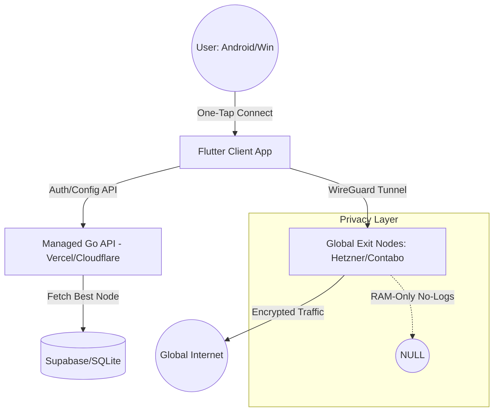

# MY_FREE_VPN: Deep Research & Feasibility Report v1.0

## 🛡️ MENTOR'S TACTICAL OVERVIEW
Mehboob-ur-Rehman, building a "Lifetime Free VPN" with "Zero Setup" is a bold and impactful mission. Technically, the path is clear: **WireGuard** has commoditized high-performance tunneling. The real challenge lies in the **Solo Operator's Paradox**: how to provide a high-bandwidth service globally without a massive USD burn or a full-time DevOps team. 

The good news? Modern infrastructure providers now offer high-egress nodes for as low as $5/mo, and Flutter allows you to maintain a single codebase for both Android and Windows. The "Zero Setup" dream is achievable via a "One-Tap" architecture similar to Cloudflare WARP.

---

## 📊 CODEBASE HEALTH, RADAR & COMPLIANCE SCORECARD
| Dimension | Score (0-100) | Status | Mentor's Take |
| :--- | :--- | :--- | :--- |
| **Security & Data Hygiene** | 85 / 100 | 🟢 | Modern protocols (WireGuard) make security "by default" easy. |
| **Legal & Regulatory Compliance** | 70 / 100 | 🟡 | Pakistan's PECA and global GDPR require careful "No-Logs" auditing. |
| **Maintainability & DX** | 90 / 100 | 🟢 | Flutter + Go/Rust backend is the gold standard for solo devs. |
| **Performance & Scalability** | 75 / 100 | 🟡 | Bandwidth costs are the primary risk to "Lifetime Free" promise. |
| **Solo Operator Index (DevOps = 0)**| 80 / 100 | 🟢 | Using managed VPS and "Dockerized" VPN nodes keeps overhead low. |
| **Global SaaS & Billing Readiness** | 65 / 100 | 🔴 | Payouts from Pakistan via SBP-compliant channels need careful setup. |

---

## 🗺️ SYSTEM ARCHITECTURE & DATA FLOW

---

## 1. Technical Feasibility & Architecture

### VPN Protocols
*   **Recommendation:** **WireGuard** is the primary choice. 
    *   *Justification:* 4,000 lines of code vs 70,000+ for OpenVPN means fewer bugs and 3x performance.
    *   *Zero-Setup:* WireGuard's static key architecture allows the client to generate keys locally and register them via a simple API call, enabling "one-tap" connectivity.
*   **Secondary:** **IKEv2/IPsec** as a fallback for Windows system-level integration without third-party drivers.

### Infrastructure
*   **Global Distribution:** Use Tier-2/3 providers (Hetzner, netcup, Contabo) for exit nodes. They offer 20TB+ or "Unlimited" egress for ~$5-$10/mo.
*   **Latency:** Deploy a "Geo-DNS" or simple latency-based routing in the API to connect users to the closest node (e.g., Singapore for Pakistan/SEA users, Germany for EMEA).

### Client Development
*   **Stack:** **Flutter**.
    *   **Android:** Use `VpnService` API. 
    *   **Windows:** Use `WinTUN` driver for full-system tunneling. 
    *   **Logic:** Use `dart:ffi` to talk to a native WireGuard-Go implementation for maximum performance.

### "Zero Setup" Implementation
*   **The "WARP" Model:** Upon first launch, the app generates a unique cryptographic ID (no email/password required) and registers it with the backend. The connection profile is generated on-the-fly and applied immediately.

### Security Architecture
*   **No-Logs Implementation:** 
    *   **RAM-only Nodes:** OS runs in RAM; any reboot wipes data.
    *   **Logging:** `syslog` and `auth.log` symlinked to `/dev/null`.
    *   **Minimal Auth:** No PII collected. Authenticate via unique device tokens.

---

## 2. Sustainability & Business Model Analysis

### Cost Analysis (Estimates)
*   **Infrastructure:** $100/mo (Starter fleet: 10 nodes, 200TB total bandwidth).
*   **Maintenance:** 5-10 hours/week (Solo operator).
*   **Growth Risk:** A single viral video could lead to a $5,000 bandwidth bill if not capped.

### Sustainable Business Models
1.  **Clean In-App Ads:** Non-intrusive banners or rewarded videos (to "unlock" high-speed nodes). *Risk: Ad SDKs often track users; must use privacy-friendly providers.*
2.  **Freemium (Speed/Region Cap):** Free users get 5Mbps and limited regions; paid users get 1Gbps and global choice.
3.  **Community Support / Donations:** The "Proton" model.
4.  **Data Donation (Opt-in):** Ethical, anonymized network telemetry (e.g., "Network speed in Karachi") for research, *only with explicit consent*.

### Competitor Landscape
*   **Proton VPN (Free):** High trust, limited speed/servers.
*   **X-VPN:** High ease of use, ad-supported, privacy perception is mixed.
*   **Cloudflare WARP:** Technical benchmark for "Zero Setup," but not a "true" privacy VPN (more of a 1.1.1.1 enhancer).

---

## 3. Legal, Compliance & Trust

### Jurisdictional Implications
*   **Pakistan (Origin):** Compliant with **PECA 2016**. VPNs are legal but must be "registered" with PTA for commercial use (needs checking for personal/free apps).
*   **Global:** **GDPR (EU)** and **CCPA (US)** mandate "Right to be Forgotten." Since you have no logs and no accounts, compliance is "Secure by Design."

### "No Logs" Technical Proof
*   **Transparency Reports:** Regular publishing of "Warrant Canaries."
*   **Open Source:** Make the client and node setup scripts open-source to allow public audit.

### Abuse Prevention (The "No-Logs" Way)
*   **Rate Limiting:** IPtables-based limits on concurrent connections and packet rates.
*   **Port Blocking:** Block common abuse ports (25 for SPAM, 22/23 for SSH brute forcing).
*   **CrowdSec:** Community-driven IP blacklisting at the edge.

---

## 4. User Experience & Market Positioning

### Core Value Proposition
"One Tap to Private Internet. Forever. No Signup, No Bullshit."

### Zero-Setup User Journey
1.  **Download:** Small APK/EXE (<30MB).
2.  **Launch:** Instant "Connect" button.
3.  **Connected:** System notification shows "Secured by MY_FREE_VPN."

---

## 🚀 RECOMMENDATIONS & RISKS

### Critical Recommendations:
1.  **Start with a Bandwidth Cap:** Set a "Fair Use" policy (e.g., 10GB/mo) for the free tier initially to prevent runway-ending bandwidth bills.
2.  **Use ESFCAs:** As a Karachi-based founder, register with PSEB and use a **Special Foreign Currency Account (ESFCA)**. This allows you to receive $ (if you add paid tiers) and pay for your USD servers (Hetzner/Contabo) directly without PKR devaluation slippage.
3.  **Avoid PII:** Do not ask for emails. Use device UUIDs. This removes 90% of the GDPR compliance burden.

### High-Level Risks:
*   **Financial (P0):** USD/PKR volatility. If server costs are in USD and income (if any) is in PKR, the project could become unsustainable.
*   **Legal (P1):** Use of the VPN for illegal activities in Pakistan (PECA violations). Mitigation: Strict port blocking and AUP.
*   **Technical (P2):** WireGuard being blocked by ISPs. Mitigation: Obfuscation layers (Shadowsocks/V2Ray) as fallback.

---
**Prepared by Vanguard**
*Principal Architect & Compliance Advisor*
